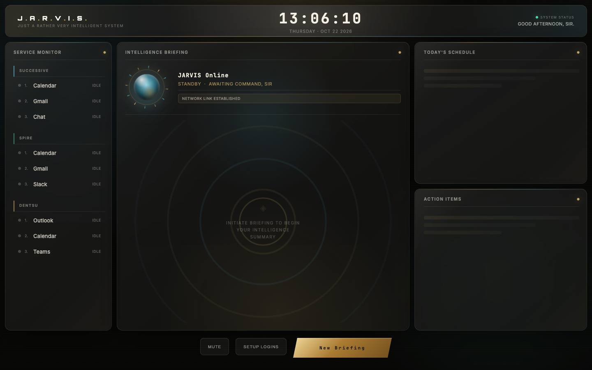
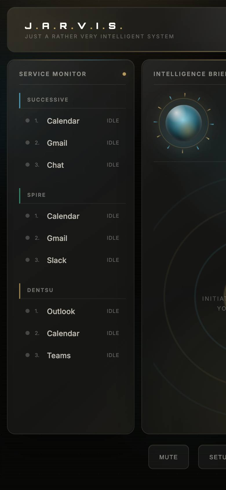

# J.A.R.V.I.S. Personal Assistant

> A local personal briefing dashboard: browser agents collect calendar and inbox signals and an LLM writes the daily briefing.

<p align="center">
  
  
</p>


J.A.R.V.I.S. is a local personal briefing dashboard. It uses Playwright browser automation instead of official Gmail, Slack, Teams, or Outlook APIs, which keeps it usable when an organization does not allow you to create OAuth apps or obtain API tokens.

## How It Works

- Login sessions are stored locally under `~/.jarvis/sessions`.
- Briefing history and last-good service snapshots are stored in `~/.jarvis/history.db`.
- Scraper diagnostics are written under `~/.jarvis/diagnostics/{run_id}/{service}` when a service fails.
- The backend uses `GROQ_API_KEY` to create the prose briefing, action items, and follow-up answers.

## Reliability Behavior

- One broken service should not stop the full briefing.
- Each scraper result includes health metadata such as duration, item count, confidence, stale state, last success, and diagnostic path.
- If a service fails but has a previous successful snapshot, J.A.R.V.I.S. shows stale data with a visible stale label.
- Browser profiles are locked so setup, re-login, polling, and manual briefings do not use the same persistent session at the same time.
- Sanitized fixture tests cover core DOM extraction paths without using live accounts.

## Useful Config

Copy `backend/.env.example` to `backend/.env`, then set:

- `GROQ_API_KEY`: required for briefing generation.
- `GMAIL_1_EMAIL`, `GMAIL_2_EMAIL`, `OUTLOOK_EMAIL`: account routing and labels.
- `POLL_INTERVAL_MINUTES`: background notification polling interval.
- `BRIEFING_TIMES`: optional local 24-hour scheduled briefings, comma-separated.
- `SCRAPER_TIMEOUT_SECONDS`: max time for one scraper attempt.
- `SCRAPER_RETRIES`: retry count after the first failed attempt.

## Testing

Run local reliability and fixture tests with:

```bash
python -m unittest discover -s tests
```

The fixture tests use synthetic HTML from `tests/fixtures` and Playwright headless Chromium. They do not open Gmail, Slack, Teams, Outlook, or Calendar accounts.
